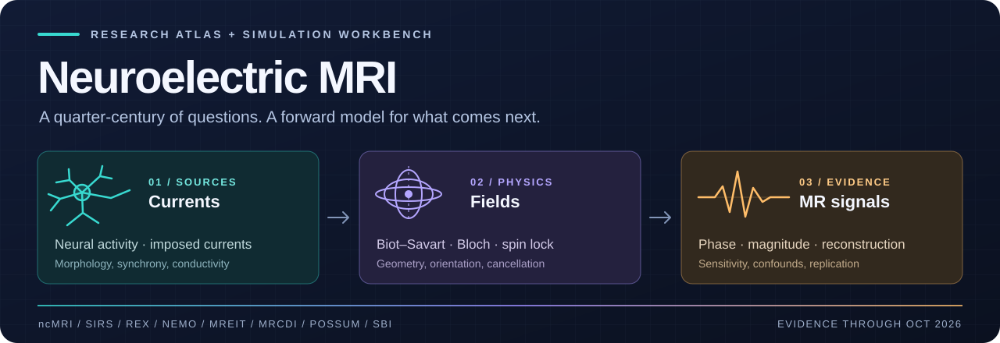
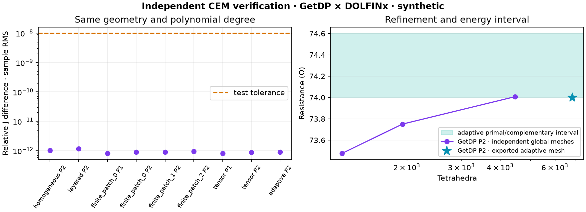
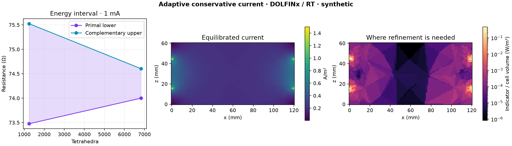
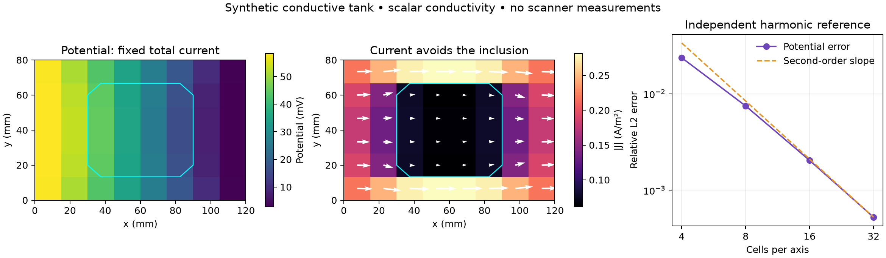

<p align="center">
  
</p>

# 🧠 Neuroelectric MRI

<p>
  <a href="docs/reading-list.md"></a>
  <a href="docs/methods.md"></a>
  <a href="docs/simulation-roadmap.md"></a>
  <a href="examples/phase_budget.py"></a>
</p>

**A research map and simulation workbench for neuronal-current MRI, MR current-density imaging, and electrical conductivity imaging.** Initial literature survey: **23 October 2026**; MREIT software and platform update: **25 October 2026**.

**[History](docs/history.md) · [Current evidence](docs/methods.md) · [MREIT](docs/mreit.md) · [Simulation roadmap](docs/simulation-roadmap.md) · [Reading list](docs/reading-list.md)**

> [!IMPORTANT]
> **Endogenous neuronal-current MRI remains an experimental research problem.** The reviewed literature does not establish a generally reproducible human method with both useful spatial localization and millisecond neural specificity. Measuring externally imposed current fields is substantially further along.

## 🧭 Three connected research tracks

| 🟢 Neuronal currents | 🟣 Electrical tissue properties | 🟠 Simulation and inference |
|---|---|---|
| Endogenous currents → magnetic fields → MR contrast | Applied currents → measured fields → conductivity estimates | Source models → scanner physics → identifiable parameters |
| ncMRI · msMRI · SIRS · REX · NEMO | MRCDI · MREIT · DT-MREIT · fMREIT | POSSUM · Bloch models · sbi4dwi |
| **Question:** can neural fields be detected specifically? | **Question:** which current and conductivity parameters can be recovered? | **Question:** what survives realistic acquisition and confounds? |
| [Explore the evidence →](docs/methods.md) | [Explore MREIT →](docs/mreit.md) | [Explore the roadmap →](docs/simulation-roadmap.md) |

## 🔬 Where the field stands

Several developments change the assessment today:

- **DIANA:** the original 2022 Science paper was **retracted on 25 September 2025**. [Retraction](https://pubmed.ncbi.nlm.nih.gov/40997196/)
- **Spin-lock MRI:** a 2026 MRI–MEG study provides a useful negative human benchmark and quantitative sensitivity estimates. [Capiglioni et al.](https://doi.org/10.1002/hbm.70624)
- **qsMRI:** a 2026 preprint makes new human detection claims; independent validation remains an open question in this survey. [Qian et al.](https://arxiv.org/abs/2601.16423v2)
- **MREIT/MRCDI:** human field measurements, conductivity-model fitting, and acquisition improvements continued well beyond the 2000s. [2024 model calibration](https://doi.org/10.1162/imag_a_00176), [2026 SMS acquisition study](https://doi.org/10.1371/journal.pone.0341731)
- **POSSUM is directly relevant:** its time-varying-field extension already explored current-induced MRI effects. [Drobnjak, Pell & Jenkinson, 2010](https://doi.org/10.1016/j.mri.2010.03.029)

## 🛠️ Building an open MREIT platform

Our proposed experimental starting point is a **Siemens Prisma 3 T**, connecting validated current/conductivity models, synchronized phantom measurements, and openly reproducible datasets.

| 🟢 Research community | 🟣 Scanner and equipment | 🟠 Open benchmarks |
|---|---|---|
| [Active groups and software audit](docs/mreit-ecosystem.md) | [Prisma program and Siemens technical brief](docs/prisma-platform.md) | [Open-data contract](docs/open-data.md) |
| SimNIBS, MRCI, CoReHA, CTI and MRSI | Scanner triggers, external gating, current monitoring and verification | Geometry, raw complex data, waveforms, clocks, provenance and null controls |

**Implemented:** analytical closed-loop fields, refocusing-aware timing, a [six-control current/MRSI benchmark](data/synthetic_mrs_current/README.md), a [conservative finite-volume tank](data/synthetic_tank/README.md), and a [DOLFINx/Gmsh complete-electrode FEM model](data/synthetic_fem/README.md) with tensor conductivity and contact impedance. The [adaptive conservative-current release](data/synthetic_fem_adaptive/README.md) adds Raviart–Thomas currents, contact-inclusive energy indicators and tagged refinement. The new [independent GetDP release](data/synthetic_getdp/README.md) verifies nine matched cases, including the exported adaptive mesh, with relative voltage/current-sample differences below 1.2×10⁻¹². **71 distinct tests** span the two environments. Red–green records: [FV](docs/tdd-conductive-tank.md) · [CEM](docs/tdd-fem.md) · [adaptivity](docs/tdd-fem-conservative.md) · [GetDP](docs/tdd-getdp.md). All checked-in datasets are synthetic.

**Latest numerical result:** one adaptive refinement reduces the relative CEM energy gap from **2.79% to 0.817%**, giving a numerical resistance interval of **74.000–74.604 Ω** for the specified phantom. This is energy/resistance error control, not a pointwise-current or MR-phase bound. [Details and assumptions](docs/fem-conservative-current.md).

**Next:** complete-circuit magnetic fields with explicit outgoing/return leads and electrode connections, then scalable PETSc solves and verified derivatives. The [PDE/FEM roadmap](docs/fem-roadmap.md) defines the next ticket and remaining geometry/error-control work. The [implementation roadmap](docs/implementation-roadmap.md) connects these gates to spectroscopy and Prisma measurements.







## 🕰️ The historical thread

**Jinhu Xiong, Peter T. Fox, and Jia-Hong Gao's 2003 paper**, “Directly mapping magnetic field effects of neuronal activity by magnetic resonance imaging,” introduced the influential **magnetic-source MRI / msMRI** claim from the University of Texas Health Science Center at San Antonio. It was an early prominent report, preceded by other proposals and experiments. [Paper](https://doi.org/10.1002/hbm.10124)

The history connects this work to **Bodurka, Petridou and Bandettini**, biological preparations, spin-lock methods, and the later DIANA debate. It also follows the parallel development of MREIT and the role of POSSUM in simulating current-induced effects. [Read the chronology →](docs/history.md)

## 📚 Repository guide

| File | Purpose |
|---|---|
| [History](docs/history.md) | San Antonio, Bandettini, early claims and later developments |
| [Methods and present evidence](docs/methods.md) | Names, mechanisms, evidence boundaries, current approaches |
| [MREIT and conductivity](docs/mreit.md) | What survived, functional MREIT, DT-MREIT and EPT distinctions |
| [MREIT groups and software](docs/mreit-ecosystem.md) | Recent activity, software availability, datasets and MRSI connection |
| [mrs-jax integration](docs/mrs-jax-integration.md) | Existing MRSI/EPSI code, targeted runtime checks and the spectroscopy development plan |
| [Implementation roadmap](docs/implementation-roadmap.md) | Delivered code, next coding ticket and evidence gates through Prisma datasets |
| [Prisma platform](docs/prisma-platform.md) | Modeling milestones, equipment requirements, synchronization and Siemens brief |
| [Open-data contract](docs/open-data.md) | Raw data, geometry, clocks, calibration and reproducibility |
| [Simulation roadmap](docs/simulation-roadmap.md) | Inspected sbi4dwi code, missing physics, concrete benchmarks |
| [Annotated reading list](docs/reading-list.md) | Study-level findings and limitations |
| [Search record](docs/search-log.md) | Search scope, dates, access limits and update procedure |
| [Source registry](references/sources.json) | Machine-readable bibliography and evidence annotations |
| [BibTeX](references/references.bib) / [CSV](references/literature.csv) | Citation-manager and spreadsheet exports |
| [Phase-budget example](examples/phase_budget.py) | Executable sanity checks for field-to-phase sensitivity |
| [Current-phantom benchmark](examples/current_phantom.py) | Closed-loop fields, signed encoding and timing perturbations |
| [Current/MRSI benchmark](data/synthetic_mrs_current/README.md) | Six controls separating injected phase and concentration; raw complex synthetic data |
| [Conductive-tank reference](docs/conductive-tank.md) | Scalar finite-volume solver, fixed-current plates, field/flux conventions and analytical checks |
| [Tank TDD record](docs/tdd-conductive-tank.md) | Failing-test and passing-implementation commits, including a diagnostic regression |
| [Complete-electrode FEM](docs/fem-complete-electrode.md) | DOLFINx/UFL tensor model, finite electrodes, contact impedance and analytical checks |
| [PDE/FEM roadmap](docs/fem-roadmap.md) | Error control, conservative currents, GetDP comparisons, PETSc/MPI, MFEM and adjoints |
| [FEM TDD record](docs/tdd-fem.md) | Recorded failing/passing cycles, convergence-driven refinement and CAD-tag regression |
| [Conservative current and adaptivity](docs/fem-conservative-current.md) | RT reconstruction, energy intervals, tagged refinement and restartable meshes |
| [Independent GetDP verification](docs/getdp-verification.md) | Native CEM, nine-case comparison, tested adaptive mesh conversion and solver provenance |

## 🏷️ Why this name?

`neuroelectric-mri` is a useful umbrella: it accommodates endogenous current detection, injected-current calibration, and tissue conductivity without declaring any contested technique successful. The conventional narrow literature term is **neuronal-current MRI (ncMRI)**. Alternative repository names are `neuronal-current-mri` for a narrower survey or `bioelectric-mri` for eventual cardiac and peripheral-nerve coverage. NEMO, NAMO, and DIANA already identify particular methods and would make confusing umbrella names.

## ⚡ Run the analytical benchmarks

Python 3.10+; standard library only:

```sh
python3 examples/phase_budget.py
python3 examples/phase_budget.py --csv data/phase_budget.csv
python3 examples/current_phantom.py --output data/synthetic_loop
python3 -m unittest discover -s tests -v
python3 scripts/build_references.py --check
```

The standard-library examples compute ideal phase budgets, closed-wire-loop fields, cancellation cases and timing-dependent phase errors. Spectroscopy tests skip if mrs-jax is unavailable; tank tests skip if NumPy/SciPy are unavailable. FEM tests require a separate DOLFINx environment. To run the spectroscopy/FV workbench and regenerate its numerical fixtures:

```sh
python -m pip install -r requirements-simulation.txt
python examples/mrs_current_benchmark.py --output /tmp/synthetic-mrs-current
python examples/tank_benchmark.py --output /tmp/synthetic-tank --plot
python -m unittest discover -s tests -v
```

For just the FV tank, install `requirements-tank.txt`; matplotlib is optional for its figure. For the FEM suite, install `requirements-fem.txt` in a separate environment and follow the [FEM reproduction instructions](docs/fem-complete-electrode.md#reproduce). Add the native solver using the [GetDP reproduction instructions](docs/getdp-verification.md#reproduce) for independent comparisons. The workbench does not perform conductivity inversion or reproduce an acquired experiment. No changes to sbi4dwi are required.

For a research program, start with calibrated current phantoms and artifact controls; then test whether plausible neural sources remain identifiable after voxel averaging, acquisition, and nuisance variability. Simulation-based inference becomes useful once this forward problem and its null cases are credible.
