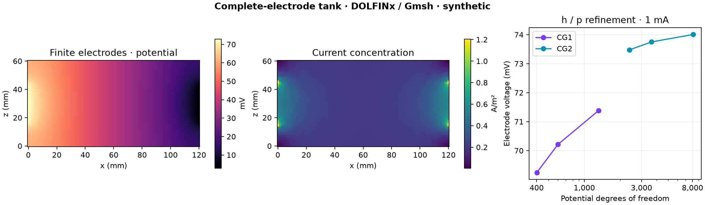

# 🟣 Complete-electrode FEM benchmark

**Synthetic only.** A 120×80×60 mm conductive tank with current-controlled finite electrodes, contact impedance and independent analytical checks. [Implementation and conventions](../../docs/fem-complete-electrode.md) · [FEM roadmap](../../docs/fem-roadmap.md) · [TDD evidence](../../docs/tdd-fem.md).

| Artifact | Contents |
|---|---|
| `homogeneous.msh`, `layered.msh` | Gmsh MSH 4.1 tetrahedra, physical material and exterior facet tags |
| `finite_patch_0.msh` … `finite_patch_2.msh` | Three meshes with electrode-edge grading, coarsest to finest |
| `fields.npz` | Finest CG2 potential, reversed/off controls, DG1 E/J, geometry, cell tags, local dof maps and a y=40 mm slice |
| `metrics.csv` | Four analytical full-face cases plus six finite-patch h/p cases; current, residual and energy diagnostics |
| `parameters.json` | SI geometry/material/contact/current definitions, mesh and basis conventions |
| `manifest.json` | Source/file SHA-256, numerical package versions and platform |

At +1 mA into electrode 101 and −1 mA into 102, the finite-patch CG2 voltage reaches **74.0074 mV** on 4,462 tetrahedra / 8,116 potential dofs. The final refinement changes voltage by **0.347%**; it is not a certified remaining-error estimate. Contact impedance is **Ω·m²**, not Ω. The voltage gauge is U₁₀₂=0; electrode current is inward-positive.

Load `fields.npz` with `allow_pickle=False`. DOLFINx cell ordering differs from Gmsh ordering: use the archived geometry/dof maps. `potential_cell_dofs` indexes the ten CG2 scalar coefficients per tetrahedron; `vector_cell_dofs` indexes four DG1 vector blocks with three components each. Coordinates and fields are in metres, V, V/m and A/m². The cell tag arrays associate material labels with DOLFINx cell indices. The planar tank geometry uses four geometry vertices per tetrahedron. Field coefficients are discretization data, not voxel averages; the slice is sampled separately, slightly inside the boundary.

E/J are potential-gradient reconstructions, **not equilibrated conservative fluxes**. Bulk/contact power and electrode current use the weak/contact formulation. There are no leads, B fields, MR observations or conductivity inversion in these data. The third floating-electrode reciprocity case and rotated anisotropy are test cases, not additional archived acquisition conditions.

Regenerate with the isolated environment described in the [solver documentation](../../docs/fem-complete-electrode.md). Repeat generation is tested numerically on a fixed environment; byte identity across operating systems or library versions is not promised. The CI artifact supplies a separate Linux generation. These generated synthetic numerical artifacts are released under **CC0-1.0**, consistent with the other synthetic releases; third-party software retains its own license.
