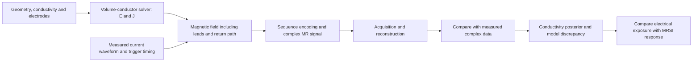

# An open MREIT simulation and measurement platform

Initial scanner: **Siemens MAGNETOM Prisma, 3 T**, with WIP access and a route to Siemens development discussions. Specification drafted 25 October 2026. Scanner software version, WIP identifiers, physical interfaces and local engineering constraints remain to be established.

The program's objective is to make current-field and conductivity experiments independently reproducible: start with a source whose field is known, measure its delivered waveform and timing, predict the MR data, and publish enough information for another lab to repeat the comparison. Leadership should be judged by prediction accuracy, uncertainty calibration, cross-site reproduction and reusable datasets.

## What exists and what remains proposed

This repository currently provides a literature atlas, ideal phase examples, and a small analytical closed-wire-loop/timing benchmark. It does **not** contain a tissue conductivity solver, scanner sequence, stimulator firmware, validated MR hardware or acquired dataset. The following milestones specify the work needed to build those capabilities.

## A common forward model

For passive quasistatic tissue, solve `div(sigma grad u) = 0`, `E = -grad u`, and `J = sigma E`, with explicit electrode/contact boundary conditions. Compute the magnetic field of the complete circuit. Rotate that field into the scanner frame before selecting its B0-parallel component. In an ideal phase-encoding experiment, `phi = -gamma integral q(t) B_parallel(t) dt`; `q(t)` is the sequence's signed sensitivity. For a real acquisition, simulate RF, gradients, relaxation, ADC timing, voxel integration and reconstruction where required.

Use **SimNIBS as a reference anatomical solver** and an independent analytic or FEM implementation for checks. Connect this to the proposed sbi4dwi/Bloch development through a versioned field/time interface. Preserve complex data and coherent nuisance fields. Keep RF-frequency CTI inputs distinct from injected-current low-frequency conductivity. An SBI posterior must include electrode/contact uncertainty, waveform and timing error, field-model discrepancy and acquisition noise; neural-network output alone does not establish identifiability.

Use **mrs-jax as the spectroscopy simulation and processing development base**: it already has metabolite maps, MRSI/EPSI kernels and a Siemens TWIX reader. The [code audit](mrs-jax-integration.md) identifies the differentiable entry point and the extensions needed for time-varying fields, actual sample timing and quantitative myo-inositol recovery. Share geometry and measured timing with the MRI field model while keeping the metabolic-response parameters distinct. Retain FSL-MRS as a reference/complementary fitter.

## Milestones with measurable exit criteria

| Milestone | Deliverable | Exit evidence |
|---|---|---|
| **M0: analytical references** | Closed-loop field, polarity and orientation nulls, refocusing-aware waveform integration, timing perturbations | Agreement with independent closed-form limits; regression tests; all examples labeled synthetic. The initial implementation is [current_phantom.py](../examples/current_phantom.py). |
| **M1: conductivity benchmark** | Homogeneous/inhomogeneous tanks, anisotropic inclusions, contact impedance, full return circuit; reference FEM runs | Mesh-convergence curves, current conservation, boundary-condition checks, comparison of independent solvers, known non-identifiable cases. Withheld geometries and montages for inversion evaluation. |
| **M2: bench timing and current platform** | Logged trigger input/output, waveform delivery into characterized loads, independent current/voltage acquisition | Latency/jitter distributions, drift, pulse-area accuracy, compliance/fault logs, missed/extra-trigger tests, reproducible firmware and calibration records. No scanner needed for this gate. |
| **M3: Prisma wire-loop reference dataset** | Registered loop geometry, current-off and reversed-polarity scans, deliberate timing offsets, repeated positions/orientations | Predicted-versus-measured complex phase, polarity scaling, spatial residual maps and uncertainty budget; measured timing and current traces for every run. Configuration-specific MR engineering clearance precedes scanning. |
| **M4: conductive-phantom dataset** | Independently characterized conductivity contrasts, multiple current patterns, repeat sessions | Conductivity/J/E recovery on held-out current patterns; distinguish parameter uncertainty from model mismatch. Release failed/null runs as well as successful runs. |
| **M5: independent reproduction** | Same reference object/protocol at another site or scanner configuration | Frozen analysis predicts held-out data within prespecified uncertainty; report transfer failures. Only then prioritize human MRCDI plus MRSI, using the site's approved equipment and study pathway. |

For every physical measurement, define acceptance thresholds from the intended phase accuracy and measured noise **before** evaluating the result. Example engineering targets such as 1% pulse-area error are proposals to assess, not established requirements or evidence of MR safety. Compare bias and repeatability, not only correlation. For inversion, report posterior coverage and predictive performance; a visually plausible conductivity map is insufficient.

## Scanner synchronization: three distinct modes

**1. Scanner is the timing master — first implementation.** A sequence event produces an approved output trigger; a deterministic external controller schedules a preloaded current waveform; an independent acquisition path logs the trigger and delivered current. Trigger once per encoding unit where possible, not merely once per entire scan. Explicitly label whether an event identifies an RF block, slice, echo, shot or volume, and account for dummy acquisitions. Host Python can configure and collect logs; it should not be responsible for precise pulse timing through USB or network scheduling.

**2. External gating — a separately verified option.** An external controller may request continuation of a preloaded sequence through a supported scanner trigger input. Verify gating latency, allowed timing variability, timeout behavior and how actual timing is represented in raw-data headers. Avoid a circular wait between scanner and stimulator. External gating coordinates the scanner's sequence scheduler; it does not grant arbitrary external control over RF or gradients.

**3. Sequence-integrated experimental design.** Through Siemens research development or an available interpreter, place encoding, polarity changes and ADC events into a jointly specified schedule. Start with existing EPI/GRE sequences for comparison; later develop sequences optimized for conductivity identifiability and nuisance rejection. Sequence and hardware limits remain enforced by the scanner.

Pulseq has explicit output-event and trigger-wait representations: [`makeDigitalOutputPulse`](https://github.com/pulseq/pulseq/blob/master/matlab/%2Bmr/makeDigitalOutputPulse.m) exposes channel labels `osc0`, `osc1`, `ext1`; [`makeTrigger`](https://github.com/pulseq/pulseq/blob/master/matlab/%2Bmr/makeTrigger.m) documents Siemens-specific `physio1`/`physio2` labels. These software labels do not establish which physical ports or event types a particular Prisma interpreter supports. Verify them for the installed console version before designing electronics around them.

## Equipment work packages

| Subsystem | Required capability | Verification record |
|---|---|---|
| Timing controller | Preloaded schedules; monotonic hardware clock; sequence/run identifier; edge counters; missing-trigger detection; explicit arm/run/stop/fault states | Loopback timing tests and independent timebase comparison; timestamp uncertainty and clock drift |
| Current delivery | Reproducible, calibrated waveform into the declared phantom load range; current and voltage monitoring; explicit polarity convention | Load-dependent response, settling, compliance and saturation detection; waveform-integral uncertainty |
| Independent observation | Observe delivered output independently of command/DAC values | Calibration source, bandwidth, sample rate, gain/offset, filter delay and timestamp relationship |
| Scanner interface | Approved isolated signaling and supported connection path; preserve scanner gating and abort behavior | Console/interpreter versions, port mapping supplied by the site/vendor, measured event timing |
| In-room assembly | Fixed, measured geometry; known materials; complete outgoing/return path; fiducials; temperature observation where needed | Configuration drawings/photos, lead paths, registration uncertainty, MR artifact and heating measurements |
| Fault handling | Hardware-enforced limits and shutdown independent of host software; loss of trigger/link or controller fault returns to defined state | Recorded fault-injection tests; manual rearming after fault; no silent run resumption |

Prefer locating active electronics outside the scanner room where the approved facility arrangement permits, using approved isolated interfaces and only the necessary characterized assembly in the bore. Fiber signaling does not remove RF coupling through current leads. The lead/electrode/phantom geometry, coil, sequence and operating conditions must be assessed as a system by the site's MR engineering team. [Gregersen et al. (2021)](https://doi.org/10.1016/j.brs.2021.02.019) is directly relevant: it evaluates how lead construction changes coupling and identifies remaining electrode concerns. Its results are configuration-specific.

The first hardware document is a requirements and verification specification, not a patient-connected circuit design. A later human configuration requires its own electrical and MR assessment; phantom validation is not a transferable human safety claim.

## Technical brief for Siemens and the local MR team

Prepared questions; **not sent**:

1. What exact syngo MR/Numaris software build, research agreement, WIP versions, sequence-development access and Pulseq interpreter options are available on this Prisma?
2. Which supported trigger outputs and external gating inputs are accessible? Request their official electrical/interface documentation, timing semantics, event granularity and measured or specified latency/jitter.
3. Can the current EPI/GRE WIPs emit per-shot or per-encoding-event markers and export complex multicoil data with RF/ADC/echo/polarity identifiers? Can dummy and failed acquisitions be distinguished reliably?
4. Which sequence modification route best supports phase-preserving acquisition, polarity scheduling, double echoes, and later multiband experiments? What source/binary restrictions apply?
5. How can external waveform and trigger logs be associated with raw-data timestamps? Is a supported real-time interface needed, or will deterministic preloaded schedules suffice?
6. What MR equipment qualification, penetration-panel arrangement, coil/lead configuration and phantom test plan does the site require? What sequence operating envelope must be documented?
7. Which sequence files, protocol parameters, headers, reconstruction details and datasets may be redistributed? Open datasets must not silently depend on inaccessible WIP binaries.

The [2024 Prisma study](https://doi.org/10.1162/imag_a_00176) documents scanner-triggered current delivery and reports an acquisition problem attributed to synchronization. The [2026 Prisma SMS study](https://doi.org/10.1371/journal.pone.0341731) used the [CMRR multiband C2P sequence](https://www.cmrr.umn.edu/multiband/). These provide concrete starting discussions, not an assumption that the same WIP is already installed locally.

## Why the open dataset is central

Publish the experiment specification, geometry, independent current measurements, trigger logs, raw complex MR data, reconstruction and null controls together. This closes the gap between ideal simulations and experimentally recoverable conductivity. The [data contract](open-data.md) defines the initial release requirements. The [ecosystem audit](mreit-ecosystem.md) identifies reference software and possible collaborators.
