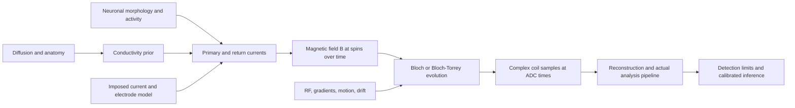

# A simulation program tied to sbi4dwi and mrs-jax

This research program began with source audits and now includes analytical phase-budget, closed-loop current/timing, [current/MRSI integration](../data/synthetic_mrs_current/README.md) and [scalar conductive-tank benchmarks](conductive-tank.md). The separate **mrs-jax** implementation is linked and pinned in the [implementation roadmap](implementation-roadmap.md), which records delivered work and the next coding ticket. The [original audit](mrs-jax-integration.md) preserves its earlier findings. No acquired MREIT result has been reproduced here.

## The historical benchmark is already unusually close

POSSUM was developed as a scanner-level simulator, with controls over acquisition and artifacts. [FSL documentation](https://pages.fmrib.ox.ac.uk/fsldocs-4c7e2c/utilities/possum.html)

The most relevant work is **Drobnjak, Pell & Jenkinson (2010)**: they extended POSSUM to model rapidly changing magnetic fields and validated it against wire-current datasets. Timing-dependent ringing extended away from the conductor along phase encoding. The implication for our work is that a field map or a final-echo phase map is insufficient: readout timing can determine where an apparent response appears. [Paper](https://doi.org/10.1016/j.mri.2010.03.029)

The [2008 ISMRM abstract](https://cds.ismrm.org/protected/08MProceedings/PDFfiles/00405.pdf) explicitly frames the experiment as neuronal-current imaging. It is worth reconstructing this simple experiment before building realistic neurons. It tests the link between imposed current, field evolution, readout, and apparent spatial localization.

## What exists locally

Audit date: 2026-10-23. sbi4dwi revision: `c6f35852f82d74beefaf4676a886640c2d4eb234`; working tree was clean. Paths below are relative to its root, with immutable source links. Findings are from inspection, not a runtime validation of the entire library.

| Component | Observed implementation | Implication |
|---|---|---|
| [scanner/objects.py](https://github.com/m9h/sbi4dwi/blob/c6f35852f82d74beefaf4676a886640c2d4eb234/dmipy_jax/simulation/scanner/objects.py) | `IsochromatPhantom` holds positions, T1, T2, M0, static per-spin off-resonance; shape checks | Useful tissue representation; add a time-dependent electrical field interface. |
| [scanner/bloch.py](https://github.com/m9h/sbi4dwi/blob/c6f35852f82d74beefaf4676a886640c2d4eb234/dmipy_jax/simulation/scanner/bloch.py) | `simulate_acquisition` integrates RF, gradients, relaxation and static off-resonance with Diffrax; sums complex spins only at the final time | Add per-spin B(r,t), ADC-time samples and coil sensitivities. It currently does not produce a k-space time series. |
| Same file, `simulate_signal` | Free Gaussian diffusion via kᵀDk damping | Useful analytical diffusion limit; not spatially resolved restricted Bloch–Torrey tissue physics. |
| [scanner/sequences.py](https://github.com/m9h/sbi4dwi/blob/c6f35852f82d74beefaf4676a886640c2d4eb234/dmipy_jax/simulation/scanner/sequences.py) | `GeneralSequence` interpolates gradients/RF and stores `adc_mask`; `SpinEchoSequence` returns zero RF/gradients | The named spin-echo class is a placeholder. `simulate_acquisition` does not consume `adc_mask`. |
| [pulseq/bloch_simulator.py](https://github.com/m9h/sbi4dwi/blob/c6f35852f82d74beefaf4676a886640c2d4eb234/dmipy_jax/pulseq/bloch_simulator.py) | Separate gradient-only precession path; starts at longitudinal equilibrium; no transverse RF drive in this vector field | Do not assume this entry point excites a usable MR signal. Distinguish it from the fuller scanner kernel. |
| [external/pulseq.py](https://github.com/m9h/sbi4dwi/blob/c6f35852f82d74beefaf4676a886640c2d4eb234/dmipy_jax/external/pulseq.py) | Pulseq conversion path exists | Validate RF/gradient units, raster boundaries, interpolation and ADC events against an oracle. |
| [pipeline/simulator.py](https://github.com/m9h/sbi4dwi/blob/c6f35852f82d74beefaf4676a886640c2d4eb234/dmipy_jax/pipeline/simulator.py) | Batched forward/prior/noise wrapper; default Rician noise; `signal_dim` uses `acquisition.bvalues` | Generalize acquisition metadata and retain complex data, rather than dropping phase into a magnitude-noise model. |
| [pipeline/train.py](https://github.com/m9h/sbi4dwi/blob/c6f35852f82d74beefaf4676a886640c2d4eb234/dmipy_jax/pipeline/train.py) | MDN/flow/score training dispatch | Reusable inference machinery after the forward/noise model is adapted. |
| [tests/verify_jax_possum_objects.py](https://github.com/m9h/sbi4dwi/blob/c6f35852f82d74beefaf4676a886640c2d4eb234/tests/verify_jax_possum_objects.py) | Object, gradient and JIT smoke checks | Its name does not establish agreement with POSSUM. |

The nearby `neurojax/src/neurojax/geometry/bem.py` inspected here contains MNE/FreeSurfer geometry and coregistration helpers. That file alone is not a verified neural-current-to-MRI magnetic forward solver. A proper FEM/BEM or compartmental magnetic-field calculation must be identified and validated separately.

## Proposed forward chain

For stimulation-response spectroscopy, reuse mrs-jax's concentration maps, basis FIDs and spatial encoding. Its current-encoding branch now supports separable current-field phase histories and explicit EPSI ADC timing; general dynamic fields, sequence evolution and sample-timed inversion remain to be developed. Keep direct current-field contrast and downstream metabolite changes as separate model parameters. FSL-MRS remains a useful independent basis/fitting reference. The [implementation roadmap](implementation-roadmap.md) distinguishes the delivered synthetic bridge from those further requirements.

At high field, first add a longitudinal perturbation callback, `delta_bz_T(position_m, time_s, parameters)`, evaluated inside the spin ODE. A vector callback is needed for ULF and general laboratory-frame physics; low-frequency transverse fields cannot simply be inserted as resonant RF in a high-field rotating frame.

For the existing convention `dM/dt = M × Ω` and signal `Mx + i My`, positive Ωz yields negative phase. The example in this repository follows that sign. Compare conventions explicitly when exchanging signals with external simulators; magnitude agreement can conceal a sign error.

## Physics and numerical requirements

- **Electrical sources:** distinguish impressed neural currents, passive volume returns and stimulation boundary currents. Enforce continuity and account for the complete circuit in phantom calculations. A neural current dipole is not an arbitrary magnetic dipole.
- **Voxel signal:** sum complex spins before measuring phase/magnitude. Average phase is not generally the phase of the average signal. Subvoxel fields can cancel in phase while causing weak magnitude loss.
- **Temporal encoding:** match source timing to RF refocusing, spin-lock phase and individual readout samples. Preserve stimulus jitter and response variability across repetitions.
- **Noise:** add complex receiver noise with coil covariance, then reconstruct. Model physiological drift, motion, RF/B0 fluctuations and structured artifacts separately. Do not treat magnitude Rician noise as a phase-noise model.
- **Precision:** compute small perturbations in a rotating frame; avoid adding pT/nT offsets to a Tesla baseline in float32. The inspected solver's `rtol=1e-5`, `atol=1e-6` settings are not a validated accuracy budget for tiny differential signals. Refine precision, temporal/spatial grids and tolerances until errors are well below the smallest reported effect.
- **Relaxation:** spin-lock experiments need an appropriate rotating-frame relaxation model. Static T1/T2 values do not automatically reproduce T1ρ dispersion. Diffusion through microscopic field gradients may require trajectories or a spatial Bloch–Torrey solution.
- **Readout:** include coil sensitivity, k-space trajectory, phase-preserving combination and exactly the analysis used experimentally. A learning algorithm must see the confounds that can mimic its target.

## Benchmarks in a useful order

| Stage | Deliverable | Acceptance condition |
|---|---|---|
| 0 — analytical budgets | Static-field phase, echo cancellation, polarity reversal, loop field | Unit/sign agreement and known symmetries; included here in simplified form. |
| 1 — POSSUM-era wire experiment | Time-varying field sampled across an EPI readout | Reproduce timing-dependent spatial patterns against an independent Bloch solver and accessible experimental data. |
| 2 — current-imaging calibration | Conducting phantom plus electrodes/leads; field-to-phase and inverse reconstruction | Predict held-out current pattern and polarity; separate field fit from conductivity recovery. |
| 3 — spin-lock transfer function | SIRS/REX frequency, amplitude, phase, B0/B1 and relaxation sweeps | Match phantom transfer curves before testing physiological amplitudes. |
| 4 — realistic neural nulls | Morphological sources, synchrony and return-current variants | Report detection and false-positive rates under fixed scan budgets, including source-off simulations. |
| 5 — inference/design | Joint electrical/microstructural posterior and sequence optimization | Coverage, posterior predictive checks and held-out geometry/protocol validation. |

Independent checks should include [KomaMRI](https://github.com/JuliaHealth/KomaMRI.jl), already used in the [off-resonance spin-lock paper](https://doi.org/10.1002/mrm.70116), and the original experimental results. Simulator agreement is necessary but not sufficient if both implement the same mistaken tissue model.

## Experiments that could be publishable

**First priority: an identifiability atlas.** Sweep source amplitude, timing, synchrony, geometry, voxel size, bandwidth and scan duration. Compare phase, magnitude and spin-lock observables under the same resource budget. Include nuisance-only datasets. Report uncertainty in the assumed source model alongside detection limits.

**Second priority: diffusion-informed conductivity inference.** Compare isotropic tissue priors, DTI-scaled tensors, and microstructure-based conductivity models. Fit Bz measurements directly, include electrode and cable uncertainty, and predict an unseen montage. Test whether diffusion data reduce out-of-sample uncertainty, rather than only improving an in-sample image. This recommendation is motivated by the [2025 anisotropy analysis](https://doi.org/10.1162/imag_a_00481) and [diffusion-model comparison](https://doi.org/10.3389/fradi.2025.1492479).

**Third priority: an artifact challenge set.** Simulate trigger delays, interrupted steady state, motion, FID beating and trial-selection effects with no neural current. An estimator that calls these datasets “neural” is not ready for physiological inference. The DIANA control/simulation work supplies a concrete precedent. [Phi Van et al.](https://doi.org/10.1126/sciadv.adl2034)

For SBI, a posterior over a strictly positive source amplitude cannot test a zero-source hypothesis. Include an explicit source-off model or calibrated detection test, nuisance marginalization and simulation-based calibration. More expressive inference cannot recover information absent from the measurement or rescue an incorrect forward model.

## Analytical example interpretation

`examples/phase_budget.py` uses SI units internally and reports idealized uniform-field phase and equal-weight ±field cancellation. For a 0.1 nT field lasting 40 ms, the absolute phase is about **0.00107 rad (0.0613°)**. With equal positive and negative fields, the net phase vanishes and the relative magnitude loss is about **5.73 × 10⁻⁷**. These are mathematical examples, not asserted physiological field distributions.

The optional paired-measurement calculation assumes independent Gaussian phase noise with standard deviation 0.01 rad per observation. Its required pair count is an ideal SNR calculation, not a detection-power analysis or realistic scan-time prediction. Coherent artifacts do not average away as independent thermal noise.
